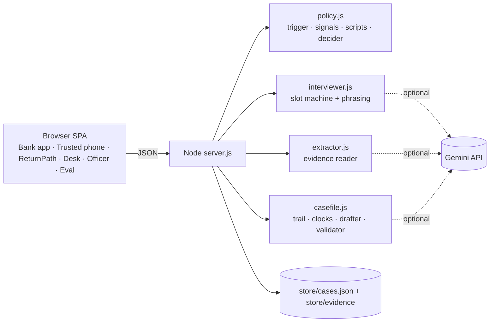

# Ruko

**Stop digital-arrest scams at the moment of payment. If the money still leaves, build the case file that gets it back.**

Google Cloud AI Builder Cup 2026 · BFSI track (Intelligent Risk, Fraud & Financial Experiences).

> India wins the detection race, loses the restitution race, and never runs the prevention race at the moment of payment.

- **Code:** https://github.com/rishabh0499/ruko
- **Shareable offline demo (runs in the browser):** https://claude.ai/artifact/QGABf7pm3vQnE3u17XWSFy
- **Live app (Gemini, Firebase Hosting):** https://ruko-ai.web.app

One **Case** object, three moments:

| Moment | What happens |
|---|---|
| **Stop** | Inside the bank app, Ruko interviews the customer in Hindi or English, asks for evidence, matches known scam scripts, and picks one of four outcomes: proceed, warn, hold + trusted contact, or escalate. |
| **Freeze** | If a coached victim overrides, everything is already captured. The 1930 / NCRP complaint is drafted inside the golden hour, with nothing retold. |
| **Return** | The same cited case file becomes the bank dispute, the cyber-cell evidence annexure, a release application draft (for an advocate), and a plain-language summary. A second door serves the innocent account holder frozen because tainted money passed through. |

## The problem, in verified numbers

| Figure | Source |
|---|---|
| ₹22,495 crore reported lost to financial cyber fraud in 2025, across 24,02,579 NCRP complaints | MHA, Rajya Sabha unstarred question 1341, 11 Feb 2026 |
| ₹55,649 crore reported 2021–2025; ₹8,189 crore held ("saved") by 1930 / CFCFRMS to 31 Dec 2025 | Same reply (yearly table and CFCFRMS figure) |
| 1,23,672 digital-arrest complaints in 2024, ₹1,935.51 crore lost | MHA, Rajya Sabha written reply, 12 Mar 2025 |
| 36,290 restorations worth ₹18.05 crore completed through the Money Restoration Module, 57 banks | Supreme Court, *In Re: Victims of Digital Arrest*, 2026 SCC OnLine SC 1532, 4 Aug 2026 |

Reported amounts are what complainants state, not verified losses. The gap is the point: money is reported and often held, but very little goes back, and nothing in the current system talks to the customer before a coerced payment leaves.

## Where Ruko fits India's 2026 framework

| Moment | What exists | What Ruko adds |
|---|---|---|
| **Stop** | The Supreme Court (4 Aug 2026) directed RBI to adopt an SOP for temporary debit holds and a delayed-transaction safeguard. | The hold, decided by an interview with cited reasons, a trusted contact who can only advise, and a human way out within 24 hours. Fraud models miss digital-arrest payments because the customer authorises them; Ruko asks. |
| **Freeze** | 1930 / CFCFRMS can hold money only when the complaint is fast and complete. | Everything is captured before an override, so the 1930 / NCRP complaint is drafted inside the golden hour without the victim retelling the story. |
| **Return** | MHA's SOP of 2 Jan 2026; the Money Restoration Module and Grievance Redressal Module live from April 2026. MRM restores money that is already frozen; GRM handles wrongful freezes. | ReturnPath builds the cited case file those processes need (bank dispute, cyber-cell annexure, release papers), and Scenario C serves the account holder frozen by mistake. |

Ruko works with these systems, not instead of them. Submission to 1930 / NCRP / MRM is drafted, never sent, in this prototype.

## Run it (localhost)

Requirements: **Node.js 20+**. Nothing else: no `npm install`, no database.

```bash
git clone https://github.com/rishabh0499/ruko.git && cd ruko
node server.js          # or double-click start.command on macOS
# open http://localhost:8790
```

Optional: live Gemini.

```bash
cp .env.example .env    # then put your key in GEMINI_API_KEY=
node server.js
```

Without a key, Ruko runs in **offline rules mode**: deterministic signal rules in Hindi and English, and stored results for the built-in sample evidence. The top bar shows which mode is live.

Models are **fallback chains** in `.env` (`GEMINI_MODEL_FAST`, `GEMINI_MODEL_PRO`, comma-separated). The first model that answers wins; a model that returns a quota or high-demand error is skipped for 60 seconds. Defaults are Flash-class (`gemini-3.5-flash → gemini-3.1-flash-lite → gemini-flash-latest`) because a free-tier key has no Pro quota. Tested live on 14 Oct 2026: interview signals and phrasing (≈3–8 s per turn), evidence reading with source boxes (≈11–22 s per image), narrative drafting, and Scam Check.

Tests: `npm test` (decider, validator, trigger, working days, and the 44-case eval set as a regression test).

## Trusted contact and the customer's choice

When a payment is held, the trusted contact's phone gets the SMS. They can **call** the customer and send **advice**: "It is a scam" or "I know about it". They cannot cancel anything.
- The advice appears in the customer's Bharat Bank app (a message in the chat, read aloud by Ruko, and a banner on the hold card).
- **Only the customer decides**, from their own app: **Cancel this payment** (the money stays in the account) or **Send anyway** (double confirmation).
- The fraud desk sees the advice and the customer's decision in the case and the audit log.

## Security: IDS / IPS

Ruko holds victims' evidence, bank details and an AI pipeline, so the platform itself is a target. `lib/ids.js` inspects every API request before routing:

| Rule | Detects | Action (prevent mode) |
|---|---|---|
| RK-IDS-001 | Path traversal (`../`, encoded) | Block |
| RK-IDS-002 / 003 | SQL injection, script injection (XSS) in any JSON field | Block |
| RK-IDS-004 | Prompt injection aimed at the AI (in requests and inside uploaded evidence) | Alert only: a victim may quote the scammer; the pipeline already treats it as data |
| RK-IDS-005 / 006 | Request flood; AI endpoint cost abuse | Ban 60 s / rate-limit |

On the live website the app runs in the browser, so the same engine inspects every in-app request and the flood and AI-cost rules guard the shared Gemini quota. Firebase Hosting adds a strict Content-Security-Policy (no inline script except two hashed ones; only this site, Google Fonts and the Gemini API), `frame-ancestors 'none'`, `X-Frame-Options: DENY`, HSTS and a Permissions-Policy.
| RK-IDS-007 / 008 / 011 | Scanner probes (`/.env`, `/.git`…), attack-tool user-agents, 404 enumeration | Ban / block |
| RK-IDS-009 | Forged evidence: declared file type does not match magic bytes | Block |
| RK-IDS-010 / 012 | State-change bursts on one case; malformed bodies | Alert |

- **Detect (IDS)** records; **Prevent (IPS)** also blocks and bans. Switch on the Security page.
- The local operator (loopback) is never banned or throttled. `X-Forwarded-For` is trusted only from loopback or with `TRUST_PROXY=1` behind Cloud Run.
- The Security page has a live event feed, rule hit counts, active bans and an attack simulator that replays real attack traffic from TEST-NET addresses.
- Events tied to a case also land in that case's audit log.
- Production path: Cloud Armor (WAF/IPS, rate limits) in front of Cloud Run, Cloud IDS on the VPC, events to Security Command Center.

## Voice and call audio

- Ruko, the customer and the trusted contact each speak in their own **Gemini TTS** voice (`gemini-3.8-flash-tts`, with `3.1-flash-tts-preview`, `2.5-flash-preview-tts` and `3.8-flash-lite-tts` as fallbacks). The trusted-contact call plays an Indian ringback tone, then the conversation with live captions.
- Known lines (Ruko's questions and outcomes, the customer's scripted replies, the call script) are pre-voiced in the background and cached in `store/tts/`. With sound on, Ruko speaks these fixed questions so the voice never changes mid-conversation; with sound off, Gemini phrases them freely.
- Anything without a Gemini voice yet falls back to browser speech. A voice line can never block the demo: playback has safety timeouts, and hidden tabs skip audio.
- Sound toggle: the speaker icon in the top bar, inside the Ruko sheet, or on the call screen. Browsers need one click on the page before they allow audio.
- Free-tier limit: **10 TTS requests per model per day**. With four models that is enough to voice Scenario A once a day. Enable billing on the AI Studio project for unlimited demos.

## Interface

- Light, dark and auto (follows the system) themes: switch in the top bar or with ⌘K.
- ⌘K command palette: jump to any screen, start a scenario, start the tour, switch language or theme.
- Hindi and English across customer screens; IBM Plex Sans + Plex Sans Devanagari.
- Respects reduced-motion; keyboard and screen-reader labels throughout.

## Hinglish quick start

1. Terminal mein `node server.js` chalao, browser mein `http://localhost:8790` kholo.
2. Left side pe **▶ Take the tour** dabao. Tour khud Scenario A chalata hai aur har step Hinglish mein samjhata hai. Hub pe **Judge demo** wahi tour bina click ke chalata hai.
3. Khud try karo: Scenario B (legit, hold nahi hona chahiye) aur Scenario C (frozen trader).
4. Gemini live chahiye toh `.env` mein `GEMINI_API_KEY` daalo aur server restart karo.

## Design principles

1. **LLM extracts, code decides.** Gemini reads, extracts signals with quotes, and drafts prose. Deterministic code applies the policy, does date arithmetic, and validates documents. Any Gemini signal without an exact quote from the transcript is dropped.
2. **Never auto-block for good.** The strongest action is a 24-hour hold with a human path out.
3. **Zero fabricated values.** The drafter only writes `{{fact:ID}}` placeholders. A validator scans every rendered document; any amount, account, UTR, IFSC or date not traced to a user-confirmed fact blocks the document.
4. **Three fact states**: confirmed, needs your check, missing. Never a percentage. Fact state is always set by code, so text inside an image cannot confirm itself.
5. **Honest labels.** Everything simulated carries a "Mocked" tag; see the Real vs Mocked page.

## What is real and what is mocked

| Real | Mocked / synthetic |
|---|---|
| Trigger, interview flow, decider (code) | Bharat Bank (fictional) and its session signals |
| Signal extraction (Gemini with quote checks, or rules offline) | Payee-risk list standing in for Chakshu / Suspect Registry |
| Script matching over a 15-entry library: keywords plus Gemini embeddings | Trusted-contact SMS and call (shown on a simulated phone) |
| Evidence reading with source boxes (Gemini; offline uses stored ground truth for samples) | 1930 / NCRP / bank submission (drafted, never submitted) |
| Money trail, RBI working-day clocks, document validator | Officer view authentication |
| Drafting into fixed templates | All people, accounts, documents and the eval set |
| Scam Check, voice input (Gemini transcription), semantic script matching (Gemini embeddings) | Ruko speaks pre-recorded Gemini TTS lines; a two-way Gemini Live conversation is roadmap |

## Architecture (local build)



Production path: Firebase Hosting front end; Cloud Run API in asia-south1 (min instances 1 on the demo path); agents on the Agent Development Kit deployed to Vertex AI Agent Engine; scam-script library on Vertex AI embeddings; Firestore and Cloud Storage with signed expiring URLs; bank integration as a step-up at authorisation, like 3-D Secure.

## Evaluation

Run it on the **Evaluation** page. Offline rules on the team-written set: 20/20 scams stopped, 0/20 legitimate transfers held, 4/4 red-team cases. That set was written by the team from public advisories and news reports, so treat these numbers as a regression test, not a field-accuracy claim. Extraction precision is only reported with a Gemini key, because offline mode would be scoring its own ground truth.

Semantic script matching (Gemini `gemini-embedding-001`, 768 dims) was calibrated on the same 40 conversations: the highest-scoring legitimate sentence reached cosine 0.834, so the threshold is 0.86 (about 0.03 above it). At that threshold no legitimate sentence matches, 19 of 20 scam conversations match at least one script, and the embeddings catch sentences the keyword matcher misses (for example "He said not to tell anyone or I will be arrested"). The threshold was chosen on this set, so treat it as a starting point that real cases must re-check. Regenerate after editing the library: `node scripts/embed-scripts.mjs 0.86`.

## Project layout

```
server.js               HTTP server, routes, storage
lib/policy.js           trigger, offline signals, script matcher, decider
lib/interviewer.js      interview engine (code picks the move, Gemini phrases it)
lib/extractor.js        evidence reader and fact merging
lib/casefile.js         money trail, clocks, drafter, validator
lib/gemini.js           Gemini REST client with timeouts, usage and cost
data/                   scenarios, eval set, scam scripts, mock registry
public/                 the single-page app (no build step)
public/js/shared/evidence.js  synthetic evidence: renders images and gives ground truth
test/                   node:test unit tests
```

## Deploy

The live site is a static build on Firebase Hosting (free Spark plan): `node scripts/build-static.mjs web && node scripts/deploy-firebase.mjs`. The whole app runs in the browser and calls Gemini directly, with a key limited to the Gemini API on a project with no billing (Google does not allow website restrictions on service-account-bound AI Studio keys; production moves the key server-side with Firebase AI Logic and App Check). A Cloud Run path (`Dockerfile`, `deploy.sh`) is also ready for the Node server. See `docs/DEPLOY.md` (Hinglish) and `docs/VIDEO_SCRIPT.md` (3-minute video).

## Safety notes

This is a prototype. It is not legal advice, never promises a refund, and never submits anything to a bank or the police. Consent is collected before files are analysed (DPDP Act 2023). Data stays in `store/` on this computer; "Delete my case" removes the case and its files.
